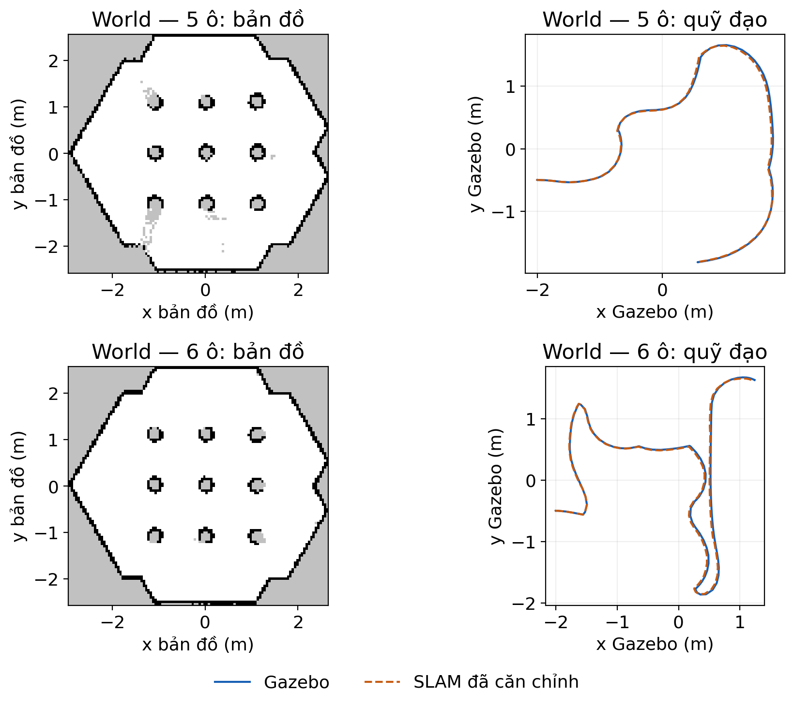
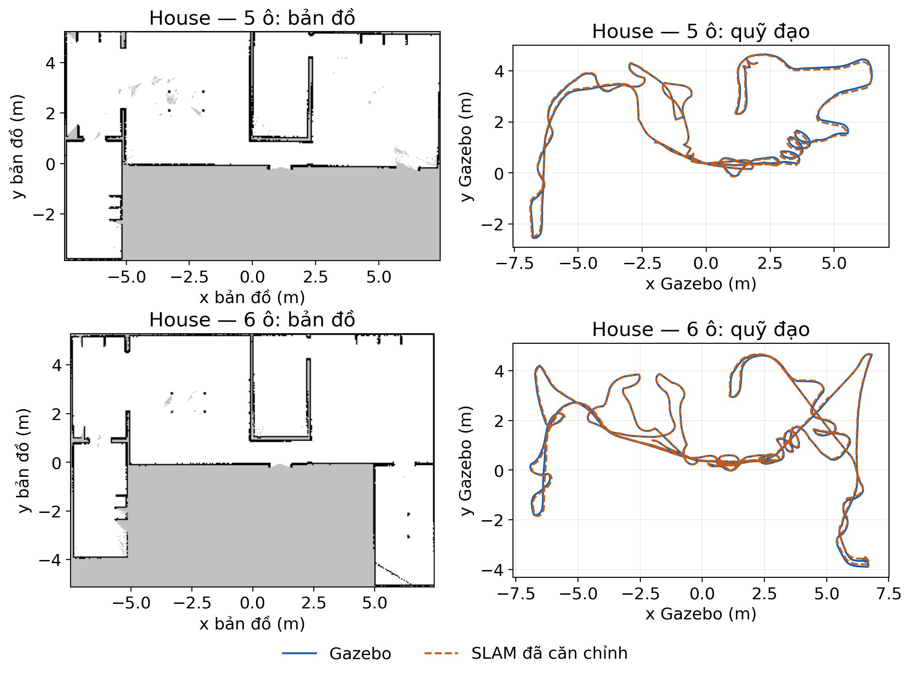
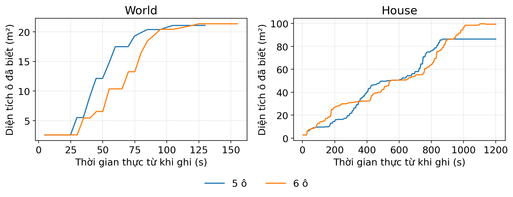
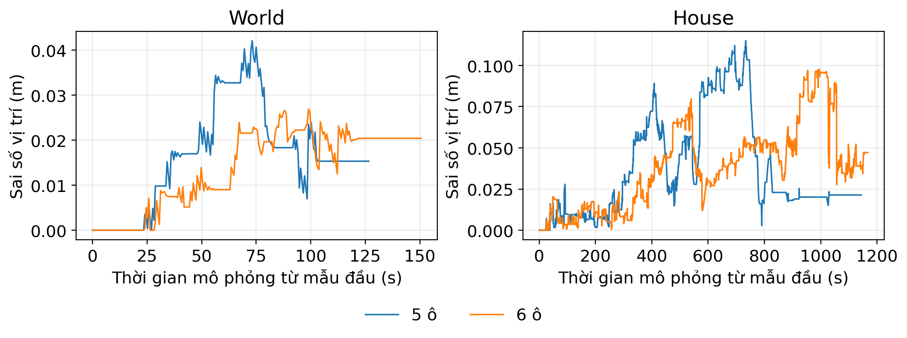
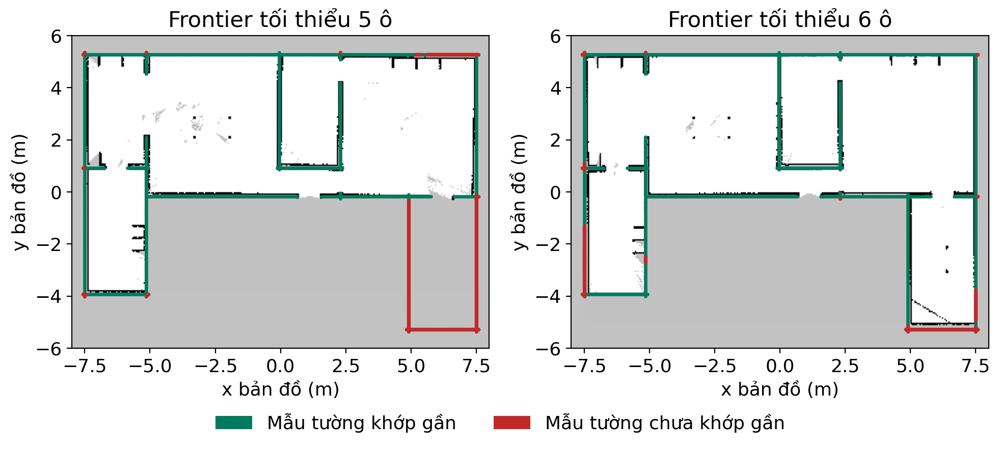
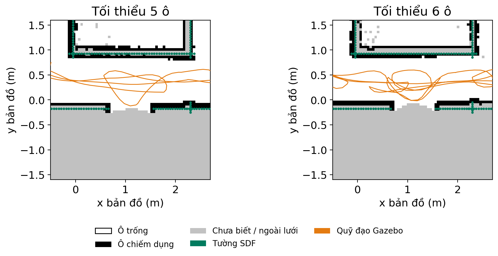
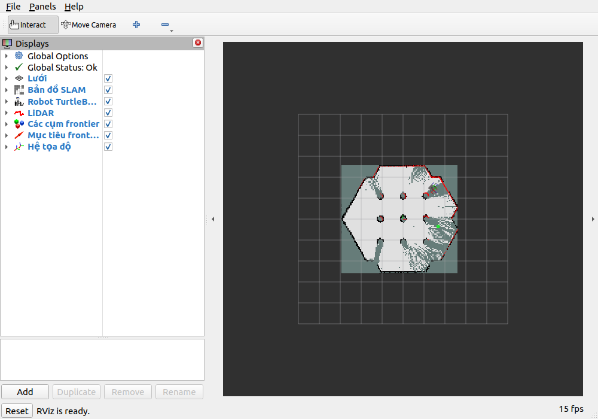
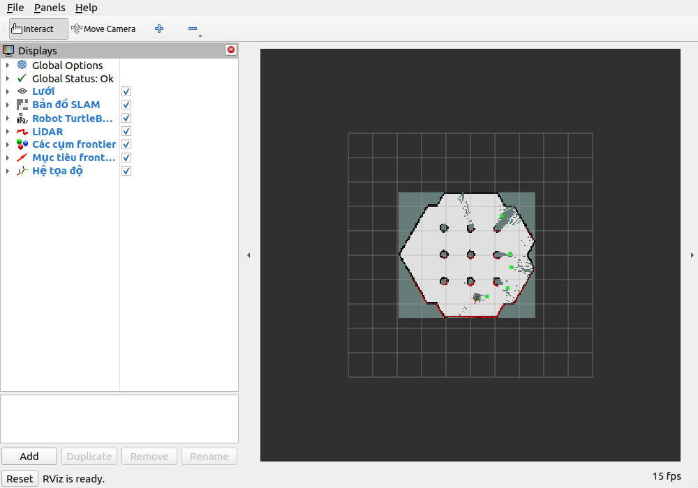
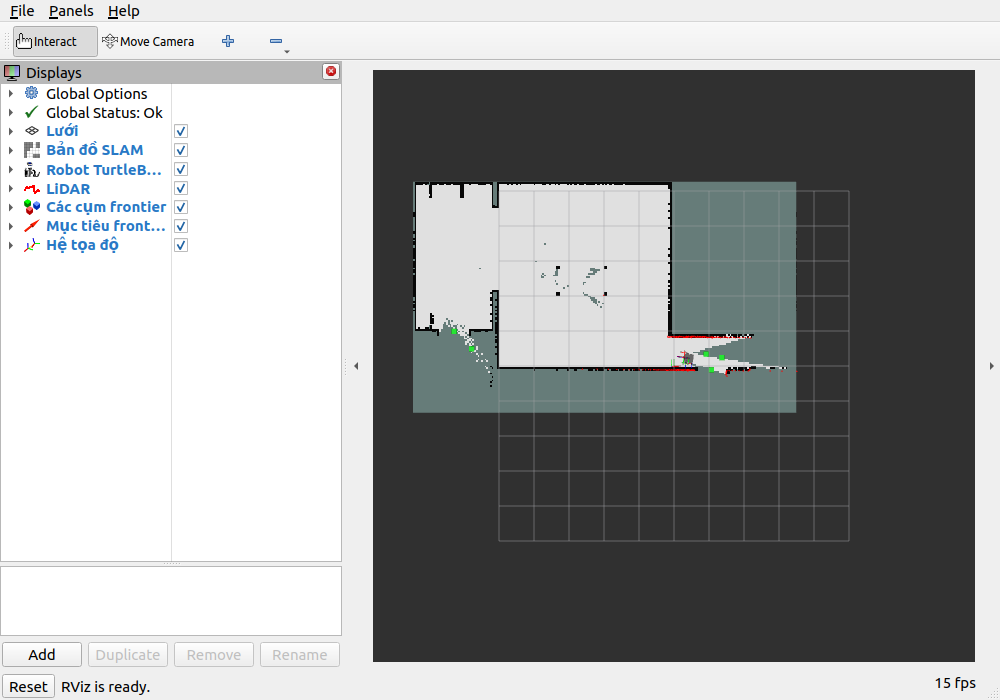
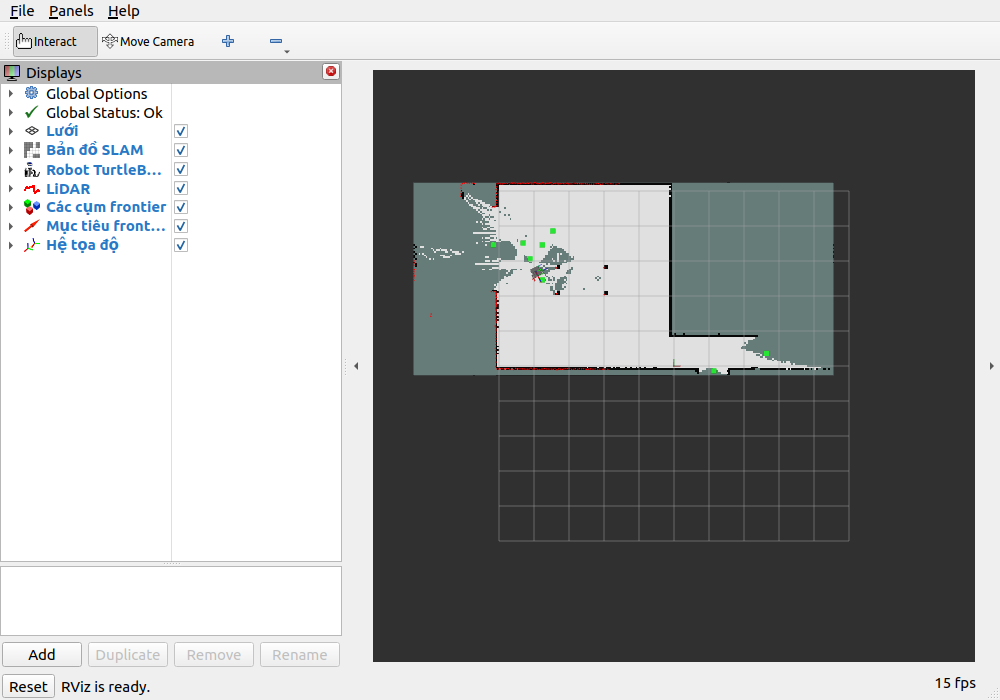

# Định vị và lập bản đồ đồng thời cho robot di động

Đề tài khảo sát hệ thống **SLAM sử dụng LiDAR 2D** cho robot TurtleBot3 Waffle Pi trong mô phỏng. Robot tự tìm vùng biên để chọn mục tiêu, di chuyển bằng Nav2 và xây dựng bản đồ trong quá trình hoạt động.

Các thử nghiệm được thực hiện trên Ubuntu 22.04, ROS 2 Humble, Gazebo Classic, SLAM Toolbox, Nav2 và RViz. Robot được chạy trong hai môi trường mô phỏng `turtlebot3_world` và `turtlebot3_house`.

## Phương pháp thực hiện

```text
Gazebo + robot ── /scan, /odom ──> SLAM Toolbox ── /map ──> Frontier
      ↑                                                       │
      └──────────────── /cmd_vel ─────────────── Nav2 <── mục tiêu
```

1. Gazebo mô phỏng robot và môi trường, cung cấp dữ liệu LiDAR và odometry.
2. SLAM Toolbox dùng các dữ liệu này để ước lượng vị trí robot và cập nhật bản đồ lưới.
3. Gói `frontier_exploration_ros2` phát hiện frontier theo WFD. Frontier là biên giữa vùng trống đã biết và vùng chưa biết.
4. Các cụm frontier được xếp thứ tự theo chi phí dựa trên MRTSP, sử dụng quy hoạch động giới hạn. Điểm mục tiêu được chọn trên vùng trống phù hợp rồi gửi cho Nav2.
5. Nav2 lập đường đi và điều khiển robot đến mục tiêu. Trong cấu hình House, NavFn được dùng cho đường đi toàn cục và DWB cho điều khiển cục bộ.
6. Bộ ghi lưu bản đồ, quỹ đạo, cấu hình và log; RViz hiển thị quá trình robot khám phá.

Đề tài thử hai ngưỡng kích thước cụm frontier: **tối thiểu 5 ô** và **tối thiểu 6 ô**. Đây là số ô tối thiểu của một cụm biên, không phải diện tích môi trường robot chắc chắn sẽ quan sát được.

## Những phần đã thực hiện

- Tích hợp mô phỏng robot, SLAM, khám phá frontier và điều hướng trên ROS 2 Humble.
- Thiết lập môi trường World và House; chạy thử với ngưỡng frontier 5 ô và 6 ô.
- Tạo giao diện demo để chọn môi trường, ngưỡng frontier và thời gian chạy; có thể mở RViz, xem log và kết quả đã lưu.
- Ghi bản đồ, quỹ đạo, cấu hình và log; phân tích sai số định vị và đối chiếu bản đồ với dữ liệu tham chiếu phù hợp cho từng môi trường.
- Khảo sát khu vực khoảng hở House và hiện tượng robot chọn lặp mục tiêu frontier.

## Thiết lập và chỉ tiêu đánh giá

Bốn lượt chính đều mở RViz, xuất phát tại cùng một vị trí trong từng môi trường và chỉ khác ngưỡng frontier 5 ô hoặc 6 ô. World có giới hạn 480 giây; House có giới hạn 1.200 giây. Bảng kết quả ghi thời gian theo **đồng hồ thực**, tính từ khi bộ ghi bắt đầu.

- **Diện tích ô đã biết:** số ô đã có thông tin nhân với bình phương độ phân giải bản đồ. Diện tích này gồm cả ô trống và ô chiếm dụng, không phải tỷ lệ diện tích sàn được bao phủ.
- **RMSE vị trí:** căn bậc hai của trung bình bình phương sai số giữa vị trí SLAM đã căn chỉnh và tư thế Gazebo tại các mẫu hợp lệ. Hai quỹ đạo được căn chỉnh theo cặp tư thế đầu tiên.
- **Hết frontier:** thời điểm hệ thống phát tín hiệu không còn tìm thấy frontier hợp lệ theo cấu hình. Tín hiệu này không chứng minh mọi khu vực đã được quan sát.
- **Đối chiếu bản đồ:** World được so với bản đồ mẫu TurtleBot3; House được đối chiếu với các mẫu tim tường lấy từ mô hình SDF.

Tư thế Gazebo và TF được ghép theo thời điểm nhận vì thông điệp `/model_states` không có dấu thời gian riêng; kết quả định vị vẫn chịu ảnh hưởng của phép đồng bộ và căn chỉnh.

## Kết quả mô phỏng

| Môi trường | Frontier tối thiểu | Thời gian ghi | Diện tích ô đã biết | RMSE vị trí | Tín hiệu hết frontier |
|---|---:|---:|---:|---:|---|
| World | 5 ô | 129,89 s | 21,07 m² | 0,020 m | 109,89 s |
| World | 6 ô | 155,12 s | 21,35 m² | 0,016 m | 135,10 s |
| House | 5 ô | 1.200,01 s | 86,29 m² | 0,047 m | Chưa ghi nhận |
| House | 6 ô | 1.200,01 s | 99,21 m² | 0,046 m | 1.195,01 s |

Mỗi cấu hình trong bảng có một lượt chính. Các chênh lệch dưới đây là kết quả quan sát được ở các lượt đó, chưa đủ để kết luận ngưỡng nào luôn tốt hơn.

### 1. Bản đồ và quỹ đạo trong World



*Hình 1. Bản đồ cuối và quỹ đạo của hai lượt World. Đường xanh là tư thế Gazebo; đường cam nét đứt là quỹ đạo SLAM sau căn chỉnh.*

- Bản đồ thu được thể hiện đường bao và các vật cản trong môi trường; quỹ đạo SLAM nằm gần quỹ đạo tham chiếu Gazebo trong hai lượt thử.
- Tỷ lệ ô trống của bản đồ mẫu đã được SLAM ghi nhận là đã biết lần lượt là **98,79%** và **99,81%** cho ngưỡng 5 và 6 ô. Trong tập ô mà cả hai bản đồ đều có nhãn để đối chiếu, tỷ lệ cùng nhãn tương ứng là **98,23%** và **96,14%**.
- Hai chỉ tiêu trên có ý nghĩa khác nhau và phụ thuộc bản đồ mẫu, các ngưỡng phân loại cùng phép căn chỉnh; chúng không phải độ chính xác tuyệt đối.

### 2. Bản đồ và quỹ đạo trong House



*Hình 2. Bản đồ cuối và quỹ đạo của hai lượt House. Trắng là ô trống; đen là ô chiếm dụng; xám là vùng chưa biết hoặc nằm ngoài lưới.*

- Ở lượt 5 ô, diện tích ô đã biết cuối là **86,29 m²**; lượt 6 ô đạt **99,21 m²**, cao hơn **12,92 m²** trong cặp thử này.
- RMSE vị trí tương ứng là **0,047 m** và **0,046 m**. Giá trị nhỏ cho thấy độ lệch vị trí trên các mẫu đã so sánh thấp, nhưng không tự cho biết robot đã khám phá hết môi trường.
- Các đường đi khác nhau và cả hai lượt còn vùng chưa có thông tin; cần xem bản đồ, quỹ đạo và thời điểm dừng cùng nhau khi đánh giá.

### 3. Diện tích bản đồ theo thời gian



*Hình 3. Diện tích ô đã biết trong World và House theo thời gian thực từ khi bộ ghi bắt đầu.*

Trong cả hai môi trường, diện tích tăng khi robot nhận thêm thông tin. Ở House, lượt 5 ô có một chuỗi mẫu liên tiếp khoảng **200 giây** với số ô đã biết không đổi; điều này chưa đủ để kết luận từng ô không thay đổi hoặc robot đứng yên. Lượt 6 ô tiếp tục mở rộng bản đồ về sau và có diện tích cuối lớn hơn trong lần thử này.

### 4. Sai số vị trí theo thời gian



*Hình 4. Sai số vị trí của các cặp tư thế hợp lệ, sau căn chỉnh theo mẫu đầu; trục ngang là thời gian mô phỏng từ mẫu đầu.*

Sai số thay đổi theo tuyến đường và thời điểm robot di chuyển. Trong các lượt House, sai số cực đại ghi được là khoảng **0,115 m** ở ngưỡng 5 ô và **0,098 m** ở ngưỡng 6 ô. Đồ thị cho biết mức sai lệch theo các mẫu đã ghi, nhưng không tự xác định nguyên nhân của từng đỉnh sai số.

### 5. Đối chiếu tường House



*Hình 5. Mẫu tim tường SDF khớp gần được đánh dấu xanh; mẫu chưa khớp gần được đánh dấu đỏ. Dung sai đối chiếu là 0,15 m.*

Từ **1.572 mẫu tường** đã chọn, lượt House 5 ô có **1.243 mẫu khớp gần** (**79,07%**), còn lượt 6 ô có **1.403 mẫu** (**89,25%**). Phần tường phía dưới bên phải được thể hiện rõ hơn ở lượt 6 ô trong cặp này. Phép đo phụ thuộc dung sai và căn chỉnh, chỉ xét những hộp tường đã chọn; nó không đánh giá đầy đủ nội thất hay tỷ lệ bao phủ sàn.

### 6. Khoảng hở và vùng xám trong House



*Hình 6. Vùng gần khoảng hở; các điểm xanh biểu diễn mẫu tường SDF, đường cam là quỹ đạo Gazebo sau khi đưa vào hệ bản đồ.*

Trong hai lượt chính, các mẫu tư thế hợp lệ gần khoảng hở không ghi nhận robot đi ra phía ngoài mốc `y = −0,40 m` trong hệ Gazebo. Đây là kết luận theo các mẫu đã lưu, không phải kiểm tra liên tục mọi thời điểm. Vùng xám biểu thị ô chưa biết hoặc ngoài lưới; đối chiếu hình học cho thấy vùng xám lớn bên dưới tường dài chủ yếu nằm ngoài cấu trúc ngôi nhà.

Log cũng cho thấy các mục tiêu frontier gần cửa đã được gửi nhiều lần. Điểm mục tiêu được chọn trên ô trống gần biên nên thông báo robot đã tới mục tiêu không đồng nghĩa với việc robot đã đi qua khoảng hở. Các dữ liệu hiện có chưa xác định được một nguyên nhân duy nhất cho vùng chưa được quan sát.

## Hình ảnh quan sát bằng RViz

| World — 5 ô | World — 6 ô |
|---|---|
|  |  |

| House — 5 ô | House — 6 ô |
|---|---|
|  |  |

Các ảnh World được chụp trong hai lượt chính. Hai ảnh House được chụp ở **những lượt minh họa riêng**; ảnh House 6 ô được chụp sau mốc khoảng 330 giây. Mỗi ảnh ghi lại một thời điểm khi bản đồ đang được cập nhật và không thay thế bản đồ cuối trong bảng kết quả.

## Hạn chế và hướng phát triển

- Lượt House 5 ô trong bảng dừng theo giới hạn 1.200 giây và chưa ghi nhận tín hiệu hết frontier. Lượt House 6 ô ghi nhận tín hiệu sau khoảng 1.195 giây, nhưng vẫn còn vùng chưa có thông tin.
- Một lượt House 5 ô không giới hạn được chạy riêng trong khoảng **24.956 giây**. RViz đóng và lượt ghi bị gián đoạn khi chưa có tín hiệu hết frontier; log cho thấy có mục tiêu được chọn lặp lại.
- House chưa có bản đồ tham chiếu đầy đủ đã xác minh để tính tỷ lệ bao phủ sàn. Cần khảo sát thêm cách chọn mục tiêu gần khoảng hở và cải thiện việc đồng bộ dữ liệu tư thế.
- Cần chạy lặp lại nhiều lần với cùng điều kiện để đánh giá độ ổn định và kiểm tra thêm trước khi thử trên robot thật.

## Nội dung của kho GitHub

Kho này hiện chứa bản sao mã nguồn **`frontier_exploration_ros2`** và các hình kết quả được trình bày trong README. Thư mục `do_an_slam` gồm cấu hình thử nghiệm, giao diện demo, công cụ ghi và phân tích dữ liệu, báo cáo cùng dữ liệu mô phỏng đang được lưu riêng trên máy; những phần đó **chưa được đưa lên kho này**.

Để lấy nội dung hiện có trên GitHub:

```bash
git clone https://github.com/Truongvantu06042004/ROBOTICS.git
```

Lệnh trên tải mã frontier và hình đã đăng. Hướng dẫn chạy giao diện demo cùng dữ liệu kết quả chi tiết nằm trong thư mục `do_an_slam` trên máy.

## Nguồn tham khảo và giấy phép

Mã khám phá frontier được kế thừa từ [mertgulerx/frontier_exploration_ros2](https://github.com/mertgulerx/frontier_exploration_ros2), tại commit [`11864e4ac6789dc81fd71bad51e43339c01deca2`](https://github.com/mertgulerx/frontier_exploration_ros2/tree/11864e4ac6789dc81fd71bad51e43339c01deca2). Thuật toán frontier và SLAM không được xây dựng từ đầu trong đề tài.

Giấy phép của mã frontier gốc là [Apache License 2.0](LICENSE). Thông tin tác giả và trích dẫn của dự án gốc được giữ trong [CITATION.cff](CITATION.cff).
